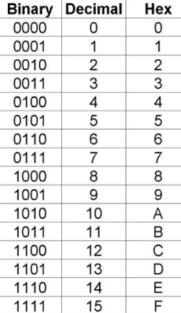
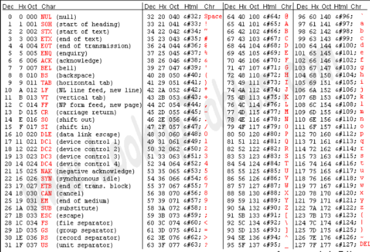

## For the Midterm exam: use CHROME

### Panopto --> midterms exam --> create --> capture --> screens and apps --> entire screen --> recording --> gets password
-recording change to name

## Use lecture notes (quiz answers) for exam

## Use slides for binary and hex tables:
- 16 bit 2s complement of number (binary)

- Given the hex value: What is this value represented in binary?

1. One difference between TRAPs and subroutines is (TRAPs use a vector table)
2. Where on the runtime stack does the frame pointer (R5) always point to? (the previous frame's frame pointer)
3. In LC3 assembly, which register is not reserved for pointing at a memory location (by convention) when using a runtime stack and a global variable section? (R3)
4. Which step of the C compilation process is dependent on the target hardware or instruction set architecture? (Code Generation)
5. The starting addresses of trap service routines are stored in the (trap vector table)
6. Two pass assembly is a solution for (a label being referenced before it is defined in your assembly code)
7. This portion of a machine language instruction tells the computer what type of instruction needs to be executed. (Opcode)
8. On the LC3, the starting addresses for trap service routines can be found in the (trap vector table)

1. In IEEE-754 64-bit floating point standard, bits 52 to 63 represent the fractional component of the number. (false)
2. In LC3 assembly, pseudo ops are not directly translated into machine language instructions. (true)
3. In the C programming language, dereferencing a pointer accesses the value stored at the memory address they point to. (true)
4. On the LC3 the least significant 4 bits of an instruction indicate the opcode. (false)
5. There is no difference between TRAP service routines and subroutines. (false)
6. Immediate addressing refers to when an operand is stored inside of the instruction itself. (true)
7. Two’s Complement is a way of representing positive and negative binary numbers. (True)
8. A stack overflow is when your program attempts to pop from an empty stack. (False)
9. It is impossible to use multiplication in a C program that is compiled to run on the LC3 instruction set architecture because the LC3 does not have a multiply instruction. (false)

Gives symbolic names to values
○ don’t need to know which register or memory location
● Provides abstraction of underlying hardware
○ operations do not depend on instruction set
○ example: can write “a = b * c”, even though LC-3 doesn’t have a multiply
instruction
● Provides expressiveness
○ use meaningful symbols that convey meaning
○ simple expressions for common control patterns (if-then-else)
● Enhances code readability
● Safeguards against bugs
○ can enforce rules or conditions at compile-time or run-time
● If it can be specified in C then it MUST be possible to implement in assembly

Explain why the runtime stack is used to create complex programs. Why not use fixed memory addresses instead? (to support recursion, nested function calls, and reusable local variables efficiently)

Explain why high level language programming languages like C need to be compiled to run on your computer. It needs to be translated into machine language instructions, the object file, as the computer only uses/understands machine language.

What is overflow in binary addition? What problems can overflow cause? When two positives add and equal a negative (1 'overflows at the end of the addition), that is overflow, and is invalid

If computer only executes binary machine language, how is it possible for your computer to execute code from high level languages like C? The compiler, it goes through the steps of source code analysis, code generation, and then uses the symbol table.
